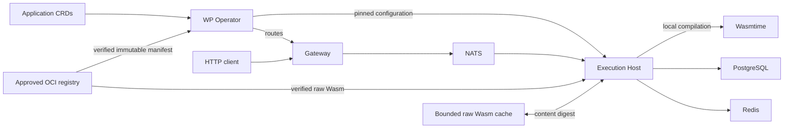

# Architecture

Technology decisions, system design, and design constraints for wasm-platform. For coding conventions, see [standards.md](standards.md). For project overview and quick-start, see the [README](../README.md).

---

## 1. Key Technology Decisions

### Runtime: Wasmtime

| Runtime | Strengths | Best For |
|---|---|---|
| **Wasmtime** | Bytecode Alliance-backed, excellent WASI support, mature Cranelift JIT, strong security sandbox | Production-grade, spec-compliant environments |
| **WasmEdge** | Very fast cold-start (~0.5ms), built-in networking/async, WASI-NN for AI workloads | Ultra-low-latency FaaS with edge ambitions |

**Decision:** Wasmtime. Strongest ecosystem, most predictable WASI compatibility, excellent Cranelift code generation. WasmEdge is worth benchmarking later if sub-millisecond cold-start becomes a hard requirement.

### Control Plane Language: Rust + Go

**Decision:** Go for the Kubernetes operator (where `controller-runtime` and `kubebuilder` are strongest), Rust for the execution host and gateway (where Wasmtime's native API, `wit-bindgen` type sharing, and zero-cost abstractions matter most).

### Guest ↔ Host Interface: WASI + the Component Model

The **WebAssembly Component Model** with **WIT (WebAssembly Interface Types)** defines the contract between guest modules and the host:

- Strongly-typed, language-agnostic interfaces for SQL and KV abstractions
- Capability-based security (guests can only call what the host explicitly provides)
- Composability (modules can be linked together)

The platform defines its own WIT world in [`framework/runtime.wit`](../framework/runtime.wit) — the source of truth for the platform's API surface. Two worlds are defined:

- **`message-application`** — exports `on-message: func(payload: list<u8>)`. For apps triggered by NATS subjects.
- **`http-application`** — exports `on-request` with typed `http-request` / `http-response` records, giving module authors a clean interface with no manual parsing.

The WASI HTTP resource model is explicitly not used; custom records are simpler to implement on the host and sufficient for a buffered FaaS model.

Both worlds import a `log` interface. Guests emit structured log entries via explicit levels (`debug`, `info`, `warn`, `error`); the host forwards to `tracing` with per-app labels. A custom `log` interface is preferred over wiring WASI stdout/stderr so that level and per-app attribution are available without parsing.

### OCI Distribution

OCI artifacts carry raw binary Wasm. The operator resolves and persists immutable manifest and layer digests before publishing configuration. Hosts verify manifest and layer bytes, share raw content-addressed cache entries, and compile each component locally. Native compiled bytes never cross the cache boundary.

Both registry clients use anonymous HTTP requests with bounded responses and deadlines. Approved exact registry origins are configured by the umbrella chart. HTTPS is required except for explicitly approved localhost/loopback development origins; redirects and external layer URLs are rejected. Registries requiring authentication or token delegation are unsupported.

---

## 2. Critical Design Considerations

### Module Preparation

Preparation has bounded admission, compilation concurrency and retained component size. Compilation runs on the blocking pool; a timed-out compilation retains its capacity until the worker exits and cannot publish its result. Preparation reporting follows the same owners through admission, compilation and result disposal, so caller timeout does not imply released compiler capacity. Cache failures permit verified registry fallback; cache writes are best effort. The [execution-host contract](../components/execution-host/README.md#module-loading) and [raw-cache contract](../components/module-cache/README.md) define the limits.

### Sandboxing & Multi-Tenancy

WASM is sandboxed by default; host functions break that sandbox deliberately. Guardrails:

- **Fuel metering** — prevents infinite loops / runaway computation.
- **Memory limits** — cap linear memory per instance (e.g. 64 MB) via `InstanceLimits`.
- **Capability scoping** — modules access only the databases and queues declared in their CRD `spec`.
- **Invocation ownership and deadlines** — the invocation supervisor owns admission, blocking executions, replies, collection and drain. One monotonic budget covers queueing, guest execution, and host operations. Async Wasmtime/WASI execution yields through epochs on the blocking pool, so cancellation drops a suspended invocation and its store. Admission permits survive until execution and backend cleanup finish; see the [execution-host contract](../components/execution-host/README.md#invocation-deadlines) for external-write outcomes.

### Data Layer

Three backing stores are reconciled by the **[db-operator](https://github.com/benjamin-wright/db-operator)**. The wp-operator provisions shared PostgreSQL and Redis infrastructure on demand; the umbrella Helm chart declares NATS infrastructure.

| Store | Isolation Model |
|---|---|
| **PostgreSQL** | One shared instance per Application namespace, with per-app logical databases and dedicated SQL users. |
| **Redis** | Single shared instance. Per-app key-prefix isolation (`<namespace>/<app>/`), assigned automatically — no CRD field required. |
| **NATS** | Single shared instance. Per-app subject isolation (operator-assigned prefixed topics). |

**Connection model:** `ConfigSync` carries per-user PostgreSQL connection URLs and shared Redis connection information. PostgreSQL uses **per-app connection pools** keyed by `(database_name, username)`, lazily initialized. Redis uses a **private asynchronous connection per host call** — isolation is purely by key prefix, automatically derived from `(namespace, app)`.

The host functions translate WIT `sql.query` / `kv.get` calls into actual client calls, keeping WASM modules ignorant of the backing store.

### Data Ownership and Retention

Application namespace/name identifies persistent data: its logical SQL database and KV prefix remain stable across deletion and same-name recreation. Shared PostgreSQL instances, Redis and the execution-host Redis credential have platform scope and no Application owner. They remain until explicit administrator removal; data purge is also an administrator action.

A ResourceInventory identifies one Application UID and owns its ephemeral SQL credential and migration CRs. Recreating an Application gives those CRs fresh identities while reusing its persistent data. The db-operator owns credential Secrets through the corresponding CR UID. Inventory spec is the durable authority for bindings and cleanup obligations; status is reconstructible observation. The inventory has no Application owner reference and its own finalizer, so cleanup can outlive both the Application and individual child CRs. Application deletion waits for verified Kubernetes cleanup by default, with an explicit policy to orphan the inventory and continue cleanup independently. The [operator lifecycle contract](../components/wp-operator/README.md#sql-credential-lifecycle) defines ownership checks, legacy attestation and the limits of downstream SQL revocation.

### Event Trigger Architecture

- **HTTP** — the gateway serialises the incoming HTTP request as a platform-private JSON object and publishes it to the app's `http.<namespace>.<name>` NATS subject (auto-generated by the wp-operator; users set only `spec.trigger: http`). The execution host decodes the payload and calls `on-request` with properly typed WIT records — the module never sees JSON. The response is serialised back to JSON for the NATS reply. The internal format is opaque to platform users; a future auth middleware layer can inject headers (e.g. `x-user-id`) into the payload before publish.
- **Gateway request ownership** — a request supervisor rejects invalid routes and methods before body reads, admits valid requests without a waiting queue, and owns their body intake, broker reply reservation and buffered response lifetime. HTTP/1.1 connection tasks and parsing buffers are bounded; separate health/metrics intake stays available during application saturation. The [gateway contract](../components/gateway/README.md#request-ownership-and-limits) defines deadlines, byte limits and outcomes.
- **MessageQueue** — the execution host subscribes to per-app NATS subjects prefixed with `fn.`. The wp-operator prepends `fn.` to the user-supplied `spec.topic` before pushing config (e.g. `my-app.events` → NATS subject `fn.my-app.events`). Topic uniqueness is enforced cluster-wide on the user-supplied value before prefixing; the `fn.` and `http.` prefix classes are disjoint, so uniqueness is only checked within the same class.
- **Schedule** — (planned) a cron controller watches CRDs and emits invocation events to NATS.

### Config Sync & Scaling

Execution hosts are deployed as a **Deployment**. The wp-operator pushes configuration via gRPC: full snapshot on startup/desync, incremental deltas ongoing. On each new config, the execution host verifies the pinned OCI manifest, checks the raw module cache by layer digest, and fetches the verified layer on a miss. Every host compiles locally.

Only the elected operator leader publishes initialized configuration. Its gRPC Service selects ready publication endpoints; the webhook Service includes standby endpoints independently of publication readiness. Operator upgrades recreate the Deployment so a previous leader cannot prevent its replacement from becoming ready. A trusted shared execution-host pool may receive every Application's configuration and credentials. Gateway identities receive only routes from configuration sync.

Clients authenticate with projected Kubernetes ServiceAccount tokens for audience `wasm-platform`, requested with a ten-minute lifetime. Kubernetes issues and rotates the pod-bound tokens; clients reopen the projected file for each request. Operator and raw-cache adapters verify them with Kubernetes TokenReview and authorize exact namespace/ServiceAccount identities. Client-provided host or gateway IDs do not grant access. Expired, revoked, wrong-audience or unauthorized tokens are rejected; unavailable authentication fails closed.

Credential-bearing gRPC and raw-cache traffic requires Istio ambient mTLS with explicit workload allowlists. Istiod, CNI and ztunnel must be installed before protected workloads deploy. Istio issues and renews workload certificates under its [certificate lifecycle](https://istio.io/latest/docs/concepts/security/); expired or untrusted identities cannot establish mTLS. Health, webhook and public gateway traffic retain their separate access paths. See the [umbrella chart](../helm/wasm-platform/templates/) for identity, projection and policy declarations.

Scaling targets concurrent invocations (not CPU/memory). A single execution host can run thousands of concurrent WASM instances. HPA with a custom metric or KEDA for event-driven scaling.

**NATS queue groups:** Each execution host replica subscribes via `queue_subscribe` using the topic name as the queue group. NATS delivers each message to exactly one replica in the group, matching the Kafka consumer-group pattern. This prevents duplicate invocations during horizontal scaling and rolling updates. Old replicas that are draining leave the queue group naturally when their NATS connection closes.

---

## 3. System Architecture

### Component Responsibilities

| Component | Language | Responsibility |
|---|---|---|
| **WP Operator** | Go | Reconciles `Application` CRDs, provisions shared infrastructure and per-app SQL bindings, and records resource ownership and cleanup. Pushes credentials and config to execution hosts and routes to the gateway via gRPC. |
| **Execution Host** | Rust | Syncs config from operator. Loads modules via the module cache. Subscribes to per-app NATS subjects. Executes WASM modules with scoped host functions (SQL, KV, messaging). |
| **Gateway** | Rust | Translates HTTP requests to NATS request-reply based on operator-pushed route table. Method enforcement, timeout handling. |
| **Module Cache** | Rust | Stores and serves verified raw Wasm bytes keyed by content digest. |
| **Token Service** | TBD | Separately scalable service for minting JWT tokens. |
| **Trigger Layer** | TBD | Cron scheduler dispatching invocation events to NATS. |
| **Data Layer** | Managed | [db-operator](https://github.com/benjamin-wright/db-operator) reconciles PostgreSQL, Redis and NATS CRs under their platform resource owners. |

### Invocation Flow (HTTP)

1. Request arrives at gateway → serialised as platform JSON → published to `http.<namespace>.<name>` NATS subject with a reply subject.
2. Execution host looks up the app config by subject → retrieves the locally compiled `Component`.
3. Execution host instantiates the module → binds scoped host functions → calls `on-request` with typed WIT records.
4. Guest runs, may call `sql`/`kv`/`messaging` imports → returns an `HttpResponse`.
5. Execution host serialises the response as JSON → publishes to NATS reply subject → gateway constructs HTTP response.

---

## 4. Deployment

### Helm Chart Structure

All platform components are deployed from a single Helm chart at `helm/wasm-platform/`. Templates are split into per-component subdirectories (`templates/wp-operator/`, `templates/execution-host/`, `templates/gateway/`, `templates/module-cache/`, `templates/databases/`) purely for navigation — Helm flattens them at render time.

`values.yaml` is nested per component (`wpOperator`, `executionHost`, `gateway`, `moduleCache`, `databases`). Workload names are deterministic (e.g. `wp-operator`, not `{{ .Release.Name }}`-prefixed) so component Tiltfiles can address them via `k8s_resource()`. RBAC cluster-scoped resources use `{{ .Release.Name }}-wp-operator` for uniqueness.

The **db-operator** is installed separately as an OCI chart prerequisite in its own `db-operator` namespace. The umbrella chart renders its NATS CRs under `templates/databases/`; the wp-operator creates PostgreSQL and Redis CRs on demand.

Istio ambient is an independent infrastructure prerequisite, installed through [its Tilt definitions](../tilt/istio.Tiltfile). The umbrella chart owns workload enrollment, dedicated ServiceAccounts, TokenReview RBAC, token projections and service authorization policies. The monitoring workload joins ambient to scrape the protected raw-cache port; artifact access still requires an authorized execution-host token.

### Tilt Layout

The root `Tiltfile` renders the umbrella chart once via `helm()` + `k8s_yaml()`. Each component Tiltfile exposes a function that registers the `custom_build`, calls `k8s_resource()` for its workload, and declares component-scoped test `local_resource`s. Tilt's automatic image injection means no `image_keys` plumbing is needed — rendered manifests already reference the registry image refs.

---

## 5. Design Decisions

### Multi-Function Application CRD Shape

**Decision:** The `Application` CRD uses a `spec.functions` list. Each entry has:

- `name` — identifier unique within the Application.
- `module` — OCI image reference for the `.wasm` module.
- `trigger` — exactly one of `trigger.http` (`HttpConfig`) or `trigger.topic` (string); enforced by CEL validation.

Application-level fields (`spec.env`, `spec.sql`) are shared across all functions in the Application.

**Uniqueness:** Topic uniqueness is enforced cluster-wide (`TopicConflict`). HTTP path uniqueness is enforced the same way. Uniqueness is checked against the user-supplied value at the function level, not the application level.

---

### `spec.metrics` Schema and Validation

**Decision:** `spec.metrics` is a list of metric definitions. Each entry:

- `name` — Prometheus metric name; must match `[a-zA-Z_:][a-zA-Z0-9_:]*`, max 64 characters, must not start with `__` (Prometheus reserved prefix).
- `type` — enum: `counter` or `gauge`.
- `labels` — list of Prometheus label key strings; each must match `[a-zA-Z_][a-zA-Z0-9_]*`, max 10 entries per metric, must not include `app_name` or `app_namespace` (host-injected labels).

`spec.metrics` names must be unique within a single Application (enforced by CEL). Cross-Application uniqueness is enforced by the operator (see below). A metric `name` is the globally unique identifier — `type` and `labels` are not part of the uniqueness key.

---

### Metric Name Uniqueness Enforcement Strategy

**Decision:** Reconciler-time validation — no admission webhook.

The operator checks all existing Applications for metric name collisions at reconcile time. The Application with the oldest `creationTimestamp` owns each metric name (tiebreak: lexicographically lower `namespace/name`). An Application whose metric names collide with an existing owner enters a `MetricConflict` condition (`Ready: False`). When the owner is deleted or removes the conflicting metric name, blocked Applications are re-evaluated automatically on the next reconcile.

**Rationale:** Consistent with the existing `TopicConflict` pattern. No additional infrastructure (cert-manager, webhook configuration) is required. Reconciler-time feedback (seconds) is sufficient for a v1alpha1 API — the cost of delayed feedback is low compared to the cost of adding and maintaining webhook infrastructure.

---

### Migrations Contract

**Decision:**

- **Artifact reference:** `spec.sql.migrations.artifact` (ORAS artifact reference) plus `spec.sql.migrations.targetRevision` (numeric migration ID) at the Application level. The artifact is a tar+gzip of paired `.sql` files (`<id>-<name>-apply.sql` / `<id>-<name>-rollback.sql`) with media type `application/vnd.db-operator.migrations.v1.tar+gzip`.
- **Lifecycle owner:** The db-operator owns the migrations runner via the `PostgresMigrationSet` CRD. The wp-operator owns one set per Application UID and patches `spec.artifact` / `spec.targetRevision` when they change. The db-operator pulls the artifact, runs the SQL files inside an advisory-locked Job, and reports `Pending` / `Running` / `Ready` / `Failed` on the set's status. The migrations role is owned and rotated entirely inside the db-operator — the wp-operator does not provision a separate `migrations` `PostgresCredential`.
- **Activation gate:** The wp-operator does not push an `ApplicationConfig` to execution hosts until the `PostgresMigrationSet` reaches `Ready` phase. Applications without `spec.sql.migrations` are unaffected.
- **Failure model:** If the migration runner fails, the set enters `Failed` phase. The wp-operator sets Application `Ready: False` with reason `MigrationFailed` and withholds the desired configuration. Inspect the set's status conditions for details. Previously published configuration can continue serving. Recovery is by updating `spec.sql.migrations.artifact` (push a new immutable tag) or `spec.sql.migrations.targetRevision`; both trigger a fresh run via the same `PostgresMigrationSet`.
- **Rollback:** Bidirectional in principle (rollback files are required by the file-pair contract), but not yet wired through the platform — `targetRevision` is intended as monotonically increasing for v1alpha1. Forward-correcting SQL is the supported recovery path.

---

### Config-Sync Proto Schema

`ApplicationConfig` carries per-application configuration from the operator to execution hosts:

| Field number | Name | Description |
|---|---|---|
| 1 | `name` | Application name |
| 2 | `namespace` | Application namespace |
| 3 | `functions` | `repeated FunctionConfig` |
| 4 | `env` | `map<string, string>` |
| 5 | `sql` | `optional SqlConfig` |
| 6 | `key_value` | `optional KeyValueConfig` |
| 7 | `metrics` | `repeated MetricDefinition` |

Key message types:

- **`FunctionConfig`** — `name`, `module_ref`, `world_type` (`WorldType`), `topic` (optional string), `http_config` (optional `HttpConfig`).
- **`MetricDefinition`** — `name`, `type` (`MetricType`), `label_keys` (`repeated string`).
- **`MetricType`** enum — `METRIC_TYPE_COUNTER = 0`, `METRIC_TYPE_GAUGE = 1`.
