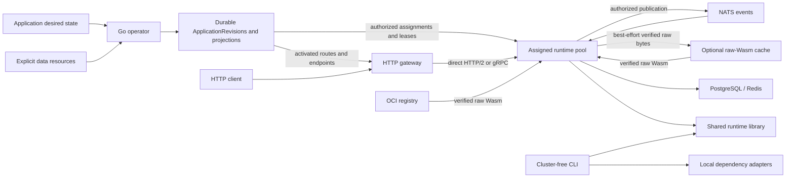
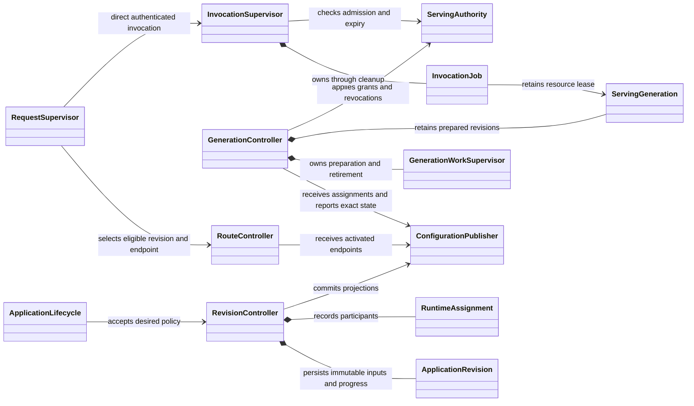
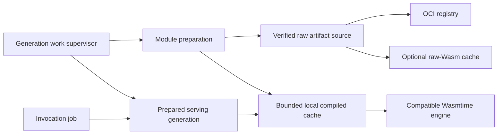

# Architecture proposal: revisioned deployments and scoped runtimes

## Purpose and use

This is the proposed target architecture. It describes intended behavior, not guarantees already implemented. Source code and [current architecture](architecture.md) establish current behavior; the [active plan](todo.md) owns implementation order, delivery policy and verification gates. Read [agent guidance](../AGENTS.md), [standards](standards.md) and affected component READMEs before implementation. Update current-state documentation as changes land and keep task evidence in the conversation.

Each authoritative state has one owner, each accepted unit of work has one lifetime owner, and consumers receive complete state through explicit interfaces. Retain Rust/Wasmtime, the Go Kubernetes operator, OCI distribution, explicit capability enforcement and durable resource cleanup. Change the deployment, transport and guest-contract boundaries described below while preserving existing applications through compatibility adapters and explicit resource adoption.

## Selected architecture

| Concern | Target decision |
|---|---|
| Deployment | Immutable `ApplicationRevision` records with separate desired, preparing, serving and retiring state; prepare, acknowledge, activate and drain explicitly. |
| Configuration | Durable, sequenced projections for assigned runtimes and gateways, with coherent snapshots, bounded replay and exact acknowledgements. |
| HTTP | Gateway dispatches directly to assigned, prepared runtimes over authenticated HTTP/2 or gRPC. NATS carries events; durable jobs have a separate delivery contract. |
| Placement and isolation | Tenant or explicitly shared trust-cohort pools receive only assigned revisions, credentials and routes, with per-Application, tenant and pool capacity limits. |
| Serving authority | Expiring serving leases permit bounded operation through configuration disconnection. Explicit revocation and lease expiry independently fence admission and capabilities. |
| Guest interfaces | Versioned WASI HTTP for new HTTP guests, a legacy adapter for existing binaries, and versioned, typed, bounded platform capability APIs. |
| Persistent data | Explicit data resources outlive deployment identity. Revisions reference scoped access bindings; adoption preserves existing retained data. |
| Runtime and development | A shared runtime library powers execution-host and a cluster-free CLI; verified raw-Wasm sharing is optional, and compiled components remain in a bounded local cache. |

These decisions do not require a pod per application or a general-purpose scheduler. Begin with explicit pool assignment and simple capacity-aware placement. Dedicated pools can isolate sensitive tenants; shared pools are an explicit trust and efficiency choice.

## Responsibility map

| Boundary | Owns | Collaborates through |
|---|---|---|
| Application lifecycle | Application UID, desired policy, accepted revision, deletion and revocation ordering | Revision, data-binding and provisioning interfaces |
| Data lifecycle | Persistent data identity, retention/adoption, access bindings and cleanup obligations | Resource inventory and focused db-operator adapters |
| Revision controller | Immutable effective inputs, preparation participants, activation, retirement and exact migration gates | Durable revision records and observations |
| Placement | Tenant/trust-cohort assignment, eligible runtime processes and capacity policy | Authorized pool assignments and prepared endpoints |
| Configuration publisher | Projection epochs/sequences, coherent snapshots, replay, recipient sessions and acknowledgements | Authenticated transport and elected authority |
| Serving authority | Current permissions, serving leases, revocation and expiry fences | Scoped handles, admission and cancellation supervisors |
| Host generation controller | Candidate/active/retiring state and owned preparation/retirement work | Runtime library, dependency adapters and revision observations |
| Serving generation | Immutable prepared modules, environment, metric bindings and capability handles | Leases retained by accepted invocation jobs |
| Gateway route controller | Activated route ownership and eligible prepared runtime endpoints | Sequenced route projection and direct invocation client |
| Work supervisors | Admission, jobs, child tasks, deadlines, replies, collection, cleanup and shutdown | Runtime and dependency interfaces |
| Shared runtime library | Wasmtime configuration, guest loading/execution, ABI adapters and capability integration | Authorized generation and invocation budget |
| Dependency adapters | External protocol, connections, bounded operations and typed cleanup outcomes | Focused interfaces; raw clients remain private |
| Guest metric catalog | Scoped schema claims, compatible registrations, retirement and bounded series | Serving-generation leases and authorized metric handles |
| Operational reporting | Health presentation, metrics and structured diagnostics | Owner snapshots and lifecycle transitions |

Controllers decide when transitions happen. Runtimes and adapters implement how. Supervisors own their component's work model; shared primitives do not force every kind of work into one generic supervisor.

## Revision, publication and activation

The operator records each immutable revision before publishing it. It contains the owning Application UID, revision identity, resolved module and migration digests, guest ABI versions, environment, declared metric schemas, capability policy and versioned resource references. Credentials remain in Secrets or equivalent protected bindings; revision CRs must not contain plaintext credentials. A durable reference must recover the exact effective input, or record that it can no longer be recovered. Reconstructing from the latest mutable spec is insufficient.

1. **Accept and resolve.** Validate desired state, reserve genuinely shared names, resolve immutable artifacts and persist the accepted revision. Keep the previously serving revision distinct from the desired revision.
2. **Assign and prepare.** Persist eligible runtime process identities and assignments before dispatching preparation. Prepare modules, capability bindings, pools and metric registrations as one candidate generation. Fence every result by Application UID, revision, process/session identity and assignment epoch.
3. **Observe readiness.** Record exact preparation acknowledgements and migration outcomes. Received configuration, completed preparation and active serving are different states. Failed or superseded work cannot acknowledge activation or resurrect deleted functions.
4. **Activate.** Initially require at least one healthy, assigned, prepared host and satisfied compatibility checks; later capacity policy may require more. Authorize serving and publish routes/endpoints for that revision. HTTP dispatch names the exact revision; event subscription ownership must prevent unprepared or stale participants from consuming its work. Each receiving runtime checks the revision and its current authority.
5. **Retire.** Stop assigning new work to superseded revisions and drain accepted work within its budgets. Retain modules, pools, registrations and resource obligations until their real owners release them. Unreachable participants remain unresolved until observed cleanup, verified termination or an effective fence establishes that they cannot resume.

Rollback deploys an earlier immutable artifact as a fresh revision; it does not mutate an existing revision or imply that a database schema rollback is safe. Old code may remain available during preparation only when its schema and authorization remain compatible. Revocation must not wait for a replacement revision to finish preparation.

The publisher produces runtime and gateway projections from durable revision state. Snapshot contents and their watermark are coherent; updates share the same epoch/sequence scheme. A single snapshot/watch boundary or replay from the snapshot watermark prevents missed changes. Bound history and recipient queues; a gap or expired history requires resynchronization. Owner-checked tombstones cover deletion and route rename.

Acknowledgements identify the recipient process/session, projection sequence, revision and transition being acknowledged. The publisher validates them and fences replaced sessions so old cleanup cannot deregister a new connection. Leadership changes establish publication authority from durable state rather than waiting for every desired Application to become healthy. Recovered authority must prevent conflicting activation or lease issuance by old and new leaders.

## Serving leases and revocation

Configuration connection health and serving permission are separate. An assigned runtime may continue serving its last prepared, authorized revision during a control-plane interruption while its serving lease remains valid. Loss of the sync stream alone does not cancel all accepted work. Report the connection as degraded independently of whether the runtime can still serve.

Leases bind the Application UID, revision, policy/authority epoch, assigned runtime process and expiry. Only the current authority can renew them. Replayed configuration, stale acknowledgements, a locally cached deadline or an old leader cannot extend permission. Enforce expiry using a conservative monotonic deadline derived from the authenticated grant, including the chosen clock uncertainty policy.

An explicit revocation received by the runtime takes effect without waiting for lease expiry or replacement preparation. Expiry or revocation stops affected admission and host operations; supervisors cancel affected work and retain ownership through bounded termination and backend cleanup. A generation resource lease preserves resources for cleanup but never grants permission to continue revoked operations. Already-committed effects remain committed.

Disconnected recipients cannot observe a new revocation immediately. The maximum permitted stale-serving interval is therefore bounded by the serving lease and any independently enforced backend revocation. State that bound honestly and choose lease/renewal policy against the availability and security requirements. Readiness reflects valid authority, required dependencies and prepared serving capacity; a stale connection alone and an expired lease have different consequences.

## HTTP, events and guest contracts

The gateway owns public HTTP parsing, routing, admission, body intake, runtime selection and response completion. It invokes an assigned prepared runtime directly over authenticated HTTP/2 or gRPC, with the Application UID, exact revision, request identity and remaining deadline. Keep the internal transport behind an invocation-client interface; its concrete protocol choice must preserve cancellation, bounded streaming and typed outcomes. Requests cannot select arbitrary runtime identities or revisions.

Gateway and runtime admission apply distinct, coordinated limits. Avoid unbounded retries or queues: a rejected or failed attempt is reported according to the request contract. Do not automatically retry requests whose side effects may already have been submitted. Streaming must retain ownership and byte/concurrency budgets until both directions and cleanup finish. A disconnected caller cancels downstream work according to the same end-to-end budget.

NATS remains the event transport, with explicit tenant-scoped publish/subscribe grants and revision-aware consumer ownership. Core NATS live events have a best-effort delivery contract. Durable jobs are a separate feature requiring durable storage, acknowledgements, retry/backoff, idempotency and dead-letter policy; broker storage alone does not supply these semantics. HTTP no longer depends on NATS request/reply in the target design.

New HTTP guests use a pinned, versioned WASI HTTP contract. Keep the existing custom HTTP world supported through an explicit legacy adapter, including its buffered request/response behavior and limits, so existing binaries remain executable. Record the guest ABI in the revision and negotiate/validate it during preparation; never silently reinterpret an existing binary under a new contract.

Platform-specific SQL, KV, messaging, logging and metrics remain explicit, versioned capability interfaces. Prefer typed failures and bounded resources or pagination/streaming where appropriate over unbounded lists or ambiguous strings. Host implementations enforce row, byte, label/series, time and concurrency limits irrespective of guest ABI. Keep guest-visible capability concepts stable while dependency adapters hide PostgreSQL, Redis and NATS details. Evolve these contracts with compatibility fixtures and generated bindings for each supported version.

## Placement, identity and capacity

Assign applications to a tenant pool or an explicitly shared trust cohort. Each pool has its own workload identity and receives only assigned configuration and necessary credentials. Authenticate the actual runtime process independently of client-supplied names, and authorize pool membership, projection access, invocation and artifact retrieval. Keep credential-bearing transport encrypted and short-lived workload identity renewable.

Per-Application, tenant and pool-wide admission, preparation, memory, database-connection and metric budgets prevent one workload from consuming every shared resource. Functions share their Application's budget, with fair admission and use of spare capacity. Placement considers available bounded capacity and prepared revisions; it does not broadcast every Application to every host. Multiple tenants may share compiled code only when immutable artifact and engine compatibility match; invocation Stores, environment, credentials, authorization and accounting remain isolated.

Dedicated per-application deployments are an available isolation policy, not a universal default. Shared trust-cohort pools preserve density, while dedicated pools narrow failure and compromise scope at the cost of idle capacity and more deployment objects. Keep the initial placement controller small and explicit; introduce more elaborate scheduling only when measured workloads require it.

## Data ownership and dependency contracts

Persistent data has an explicit identity and retention policy independent of Application name, UID or revision. Deployments reference named data resources and scoped access bindings. Separate infrastructure/data lifecycle, ephemeral credentials and migration execution; deleting code must not implicitly purge a database or KV namespace. Rebinding or adopting data is an authorized operation with verified ownership.

Preserve the existing namespace/name-derived databases and KV prefixes during migration. Import their exact identities into explicit data resources and retain their contents; do not rename, recreate or purge them as a side effect of adopting the target model. Preserve durable inventory obligations and legacy ownership evidence until verified transfer completes. A same-name new Application cannot inherit access merely through matching its predecessor's name.

Resource inventories record intended bindings before use, verify UIDs and ownership before mutation or deletion, and survive the originating deployment. Keep shared infrastructure under its own owner. Status remains reconstructible observation. Kubernetes resource disappearance does not prove backend privilege revocation or terminated database sessions; require the deployed db-operator's effective revocation contract before declaring that obligation complete.

Migrations use a distinct privileged identity and immutable artifact/target inputs. Activation checks the observed generation, artifact and exact target/current revision, not a bare `Ready` phase. Serialize conflicting migration requests and define bootstrap ordering so runtime table grants cannot block the migration creating those tables. Supported up/down migrations must remain compatible with serving code throughout intermediate and partially failed states. Destructive migrations requiring a traffic pause remain deferred until an explicit drain policy is selected. Do not equate code rollback with schema rollback.

Each external system has one ownership module with focused Rust traits or Go interfaces and private concrete clients. Startup constructs adapters. Contracts express platform operations and typed results rather than generic wrappers around library CRUD. Observations include the identity and generation they describe. Kubernetes adapters cover Application/revision reads, status/finalizers, Secret access, durable claims and provisioning through one coherent boundary; db-operator remains responsible for backend infrastructure, grants and migrations.

Genuinely public names, such as shared routes, require durable ownership claims checked at acceptance and reserved before publication. Tenant-scoped event and capability names avoid unnecessary cluster-wide collisions. Preserve declared guest metric names: scope ownership and authorization by Application UID, permit compatible shared registrations, and delay incompatible reuse until conflicting generations verifiably retire. Bound series and reject incompatible schema changes explicitly; do not silently rename metrics. Simultaneous incompatible same-name schemas across tenants require a compatible exporter/endpoint layout to be selected and validated before enabling coexistence; tenant label scoping alone does not resolve conflicting schemas. Until that gate is complete, reject incompatible coexistence explicitly.

## Artifact preparation and the shared runtime

Resolve and verify immutable OCI identities before deployment. Fetch raw Wasm directly from the registry or through an optional shared, content-addressed raw-Wasm cache; verify bytes against the pinned digest in either path. Keep finite response sizes, origin policy and deadlines. Shared cache failure can fall back to verified registry retrieval within the preparation budget.

Compile locally and retain compiled components in a bounded cache keyed by raw-Wasm digest and complete engine compatibility identity, including engine/build settings and target requirements. Native compiled artifacts do not cross the shared-cache trust boundary. Eviction is reference-aware: accepted work and retained generations keep their components alive, and their bytes remain accounted for until release. Bound compiler concurrency, peak memory, queued work and retained code; timeout does not free capacity while the compiler still runs.

Extract Wasmtime configuration, loading, ABI adapters, invocation limits and capability integration into a shared runtime library under `lib/`. Execution-host adds authenticated assignments, networking and fleet lifecycle. A cluster-free CLI uses the same runtime with local configuration and explicit local dependency adapters. Local operation must not require Kubernetes or claim to reproduce cluster placement and distributed activation.

Keep one runtime path for guest behavior and resource enforcement. A local development mode can relax explicitly identified infrastructure requirements, but must not silently bypass capability checks. Support existing application manifests through a versioned loader/adapter and expose unsupported local capabilities clearly. Use shared conformance fixtures to demonstrate that the CLI and deployed host execute supported guest contracts consistently.

### Local services managed by the CLI

`wp run` exposes a real HTTP server on localhost. KV and live-event messaging use in-memory adapters that preserve the supported capability semantics, including atomic operations, application isolation and the declared delivery behavior. Their state is ephemeral by default; neither adapter requires Docker. Keep the same guest runtime, authorization, limits and cancellation path as deployed execution.

Local SQL uses PostgreSQL so guest SQL, grants and migrations retain their production meaning. When SQL is declared, the CLI uses an explicitly configured database URL or starts/reuses a project-scoped PostgreSQL container through Docker. It selects a compatible pinned version, allocates a loopback port, waits for readiness within a deadline, provisions application databases/users/grants, applies migrations and injects connection details without logging credentials. Failed provisioning or migrations leave data intact and cannot report the application ready. Docker is required only for managed SQL; applications using HTTP, KV and messaging, or an existing SQL URL, can run without it. Report unavailable Docker, insufficient database privileges or unsupported local capabilities clearly rather than silently substituting another database dialect.

The CLI owns and identifies its managed containers and volumes, coordinates concurrent sessions, and preserves development SQL data across restarts. On normal exit it stops the managed database only after the last using session exits, retaining its volume; it never stops an external database. Resetting owned local data is an explicit operation. Never adopt, reset or delete unrelated containers, volumes or an externally supplied database. `wp test` uses isolated test data and cleans up only resources it owns, without modifying persistent `wp run` data.

## Lifetime invariants and operational evidence

- **Complete serving state:** each invocation selects one prepared immutable generation. Late preparation, deleted functions and superseded sessions cannot mutate another generation or restore removed work.
- **Independent authorization:** resource retention never confers permission. Current capability policy, serving leases and backend revocation fence both new and retained generations.
- **Owned completion:** supervisors own admitted work, replies, child tasks, completed records and cleanup. Cancellation prevents new operations but cannot undo committed effects. Release capacity only after actual termination and required cleanup.
- **Total bounds:** counts, bytes and time include requests, streams, queues, compilation, retained generations, cache storage, SQL results/connections, metric series and terminating work. Pool and tenant accounting cover the whole lifetime.
- **Recoverable truth:** revision inputs, serving decisions, participants, claims and cleanup obligations survive process loss. Projection replay and lease fencing recover recipients without guessing from the latest desired spec.
- **Truthful health:** report desired/preparing/serving revisions, synchronization health, authority validity, dependency readiness and available capacity separately. Neither receipt of configuration nor an open stream establishes serving readiness.

Lifecycle bookkeeping lives with its owner. Reporting consumes bounded snapshots or typed transitions; correct completion must not depend on Prometheus or a duplicate metrics state machine. Extend [existing monitoring](../components/monitoring/README.md) with preparation/retirement, assignment and capacity, projection/acknowledgement lag, lease expiry/revocation, dependency recovery and cache occupancy. Keep labels bounded and guest metrics separate from platform health.

Use bounded traffic and retained history to assess recovery to baseline, sustained growth and anomalies, preserving process identity, resets, scrape gaps and retention limits. Missing data is unavailable, not zero. Choose alert and budget values from measured workloads. Retain targeted correctness/security tests for revision ordering, authorization, exact migration outcomes, lease expiry, ownership, legacy ABI compatibility, direct HTTP cancellation and side effects; metrics cannot establish these guarantees.

Run builds, deployments and tests through Tilt MCP, following the plan and standards, including the deployed `e2e-tests` gate and existing fixtures. Report validation in the conversation. Documentation-only changes do not require deploying the target architecture.

## Implementation guidance and remaining policy

Implement through the ordered slices in the active plan. For each slice, identify its state/lifetime owner and invariant, read the current production path, reuse appropriate abstractions, and migrate state and transitions together. Give consumers complete values or scoped handles and remove alternate mutation paths. Keep build/generation inputs and deployment composition authoritative and reproducible.

Compatibility work is part of implementation: migrate existing data through adoption, keep legacy guest binaries and supported manifests working, and fence old transport/recipient versions before retiring adapters. Do not promise atomic mixed-version operation without a demonstrated protocol. Update current-state documentation only for guarantees delivered by the corresponding slice.

| Policy still to settle during implementation | Required resolution |
|---|---|
| Direct invocation wire protocol | HTTP/2 versus gRPC details, streaming/error envelopes, cancellation and deadline propagation; either must satisfy the selected direct path. |
| Lease and publication bounds | Lease lifetime/renewal margin, clock uncertainty, replay retention, recipient/acknowledgement budgets and recovery/fencing evidence. |
| Pool capacity and activation | Trust-cohort membership, assignment policy, per-Application/tenant/pool limits and any prepared-capacity threshold above the initial one healthy assigned host; choose values from measured workloads. |
| Cross-tenant metric export | Exporter/endpoint layout and validation for simultaneous incompatible same-name schemas; retain declared names and reject incompatible coexistence until supported. |
| Guest contract versions | Pinned WASI HTTP version, supported legacy worlds, typed capability schemas and deprecation criteria. |
| Data and schema transition | Adoption authorization, explicit retention/purge policy, compatible old-code window and exact downstream revocation/migration evidence. |
| Resource and delivery budgets | Count/byte/time limits, compiled-cache retention, stream/drain deadlines and the separate durable-job contract. |
| Deployment/build authority | Reconcile component-chart/root-load guidance in [standards](standards.md#helm-charts) and [Tilt standards](standards.md#tilt) with the current [umbrella chart](architecture.md#4-deployment); use one authority during topology migration. |

The architecture choices above are selected; the remaining policies define their bounds and compatibility details.

## Source entry points

These paths locate the current implementation to migrate; proposed types and library boundaries need not already exist.

| Work area | Start here |
|---|---|
| Application, revisions, data and publication | [Application API](../components/wp-operator/api/v1alpha1/application_types.go), [resource inventory API](../components/wp-operator/api/v1alpha1/resourceinventory_types.go), [reconciler](../components/wp-operator/internal/controller/application_controller.go), [inventory controller](../components/wp-operator/internal/controller/resourceinventory_controller.go), [provisioning](../components/wp-operator/internal/provisioning/), [configuration store](../components/wp-operator/internal/configstore/store.go), [route store](../components/wp-operator/internal/routestore/store.go) |
| Authority, projections and placement | [publication authority](../components/wp-operator/internal/authority/authority.go), [gRPC adapters](../components/wp-operator/internal/grpc/), [host config sync](../components/execution-host/src/config_sync.rs), [gateway route sync](../components/gateway/src/route_sync.rs), [protobuf contracts](../proto/), [deployment manifests](../helm/wasm-platform/templates/) |
| Generations, runtime extraction and CLI | [host startup/dispatch](../components/execution-host/src/main.rs), [configuration](../components/execution-host/src/config.rs), [modules](../components/execution-host/src/modules.rs), [runtime](../components/execution-host/src/runtime.rs), [invocation supervisor](../components/execution-host/src/invocation_supervisor.rs), [shared libraries](../lib/), [CLI component](../components/cli/) |
| Capability and metric contracts | [WIT](../framework/runtime.wit), [SQL](../components/execution-host/src/host_sql.rs), [KV](../components/execution-host/src/host_kv.rs), [messaging](../components/execution-host/src/host_messaging.rs), [SQL pools](../components/execution-host/src/sql_pool.rs), [metric registry](../components/execution-host/src/metrics.rs) |
| Direct HTTP and artifacts | [gateway](../components/gateway/src/), [legacy internal HTTP types](../lib/platform-common/src/http_types.rs), [module-cache service](../components/module-cache/src/main.rs), [OCI source](../components/execution-host/src/oci.rs), [raw-cache client](../components/execution-host/src/module_cache.rs), [artifact policy](../lib/platform-common/src/artifacts.rs) |
| Reporting and compatibility validation | [monitoring](../components/monitoring/README.md), [examples](../examples/), [e2e entry point](../tests/e2e/Tiltfile), [shared logging/health/identity](../lib/platform-common/src/) |
