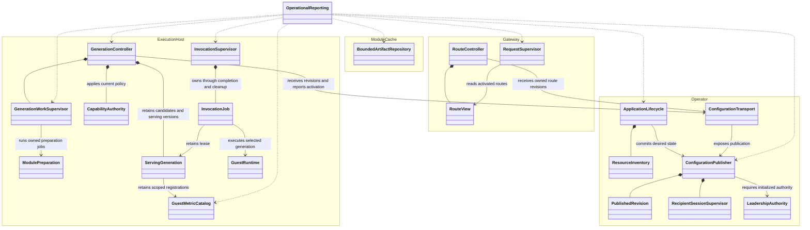
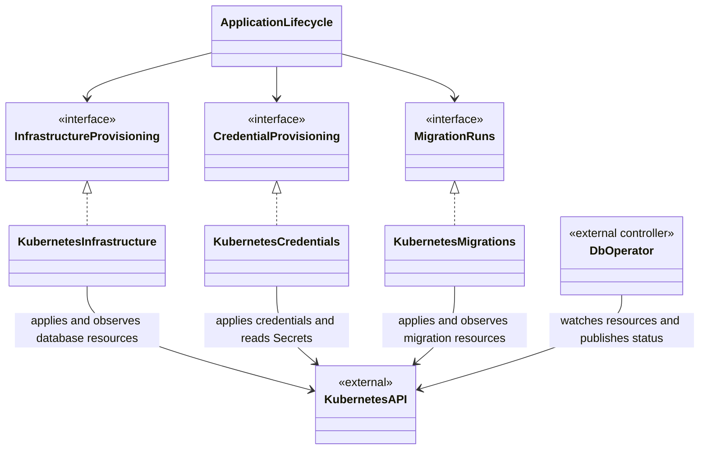
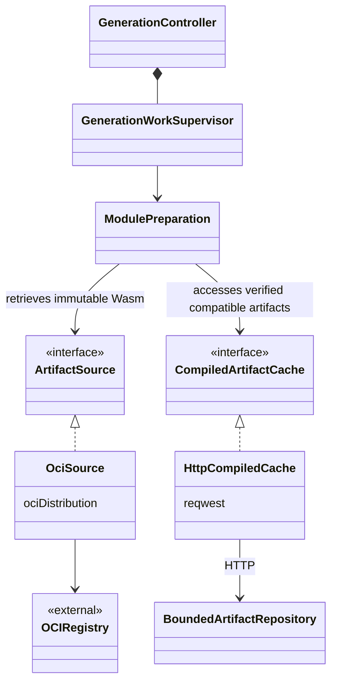
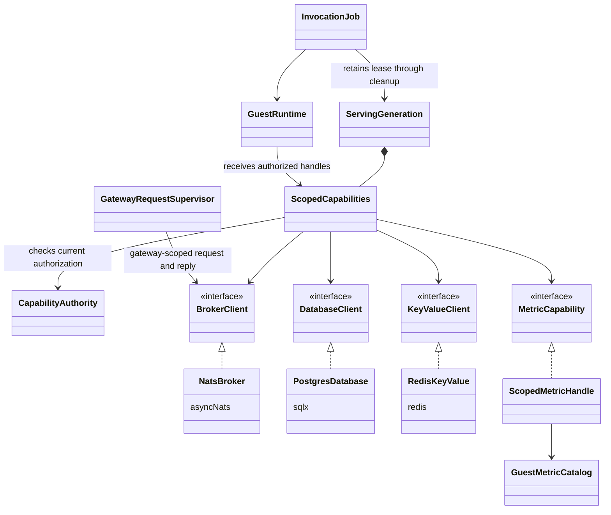

# Architecture proposal: explicit ownership and bounded lifetimes

## Purpose and use

This is the proposed target design for the platform remediation. It records the structural direction agreed in the task conversation and gives implementing agents a design to work against. It describes intended behavior, rather than claiming that these boundaries already exist.

Use the [active plan](todo.md) for task order, scope, priorities, and remediation gates. Use this proposal for responsibility boundaries and invariants. Read [agent guidance](../AGENTS.md), [standards](standards.md), [architecture](architecture.md), and the affected component READMEs before implementation. Source code establishes current behavior. Update current-state documentation as changes land; keep validation evidence in the conversation.

The north star is: **each authoritative state has one owner, each accepted unit of work has one lifetime owner, and consumers receive complete state through explicit interfaces.**

Preserve the existing deployed components, Rust/Wasmtime host, Go operator, WIT guest contract, OCI distribution, and NATS dispatch. These are boundaries within those components. File names and type names below express responsibilities; implementation should reuse suitable existing abstractions.

## Responsibility map

| Boundary | Owns | Collaborates through |
|---|---|---|
| Application lifecycle, in wp-operator | Application identity, validated policy, desired generation, persisted resource inventory, update/revocation/deletion ordering | Focused provisioning interfaces and configuration publication |
| Configuration publication, in wp-operator | Consistent published revisions, route ownership, snapshots, bounded update history, recipient sessions and acknowledgements | Authority gate and authenticated transport adapters |
| Generation controller, in execution-host | Desired/candidate/active/retired state, activation, supersession and retained generations | Owned generation-work supervisor, module preparation and current authorization |
| Serving generation, in execution-host | Immutable configuration, prepared modules, environment, metric definitions, subject bindings and scoped capability handles | Leases retained by invocation jobs |
| Capability authority, in execution-host | Current effective authorization and revocation state across retained generations, keyed by Application UID and policy revision | Generation controller, scoped handles and supervisors that enforce cancellation/drain |
| Guest metric catalog, in execution-host | Application-owned schemas, registration/retirement, bounded series and scoped metric handles | Serving-generation leases and the chosen schema-change policy |
| Work supervisors, within each component | Admission, accepted jobs, child tasks, deadlines, replies, collection, cleanup and shutdown | Runtime and dependency interfaces |
| Guest runtime, in execution-host | Wasmtime engine/store execution, WASI setup and WIT conversion | A selected generation and its authorized capability handles |
| Dependency adapters | External protocol, connections, bounded operations, cancellation/cleanup mechanics and typed outcomes | Focused interfaces consumed by controllers, supervisors and capability handles |
| Artifact repository, in module-cache | Artifact identity, authorized storage/access, integrity and finite storage/retention | Artifact transport adapter |
| Operational reporting, within each component | Metrics, health presentation and structured diagnostics | Owner snapshots and lifecycle transitions |

Controllers decide when and whether a transition happens. Runtimes and clients implement how it happens. Each supervisor owns its component's work model; shared primitives may support them without forcing all work into one generic supervisor.

## Ownership UML

Solid arrows show dependencies, filled diamonds show ownership, and dotted arrows show observation. These are responsibility views rather than an exhaustive type inventory; cross-component arrows operate through the wire contract and transport adapters.

Candidate state becomes a serving generation only after preparation succeeds and the desired identity still matches. A generation lease preserves execution resources; it does not authorize continued use of revoked permissions. Immutable capability bindings can reference revocable resources; rotation creates new bindings, and retained generations still obey revocation.

`GenerationWorkSupervisor` owns preparation/retirement children through their cancellation and cleanup budgets, and waits for them during shutdown. `GenerationController` owns desired/active state and applies current policy to `CapabilityAuthority`. Scoped handles consult that live authority for SQL, messaging, KV and guest metric operations; supervisors own any required cancellation and quiescence. Application lifecycle remains the source of desired policy and verified downstream revocation.

`GuestMetricCatalog` owns registration and retirement across overlapping generations. Handles bind the owning Application UID and declared schema; leases preserve required registrations until retirement completes. Define schema coexistence or explicit mutation rejection before allowing a changed schema to activate.

## Dependency contracts and implementations

These are internal Rust traits or Go interfaces. Component startup constructs the concrete adapters and supplies them to consumers. Raw external-library clients remain private to their owning modules. The WIT host implementations translate guest calls into internal operations using authorized handles and the invocation budget.

Within each component, each external system has one ownership module with focused exported contracts and private adapters. Share suitable implementations across components. The Kubernetes adapters below belong to the same Kubernetes interaction module and share connection machinery; that boundary also covers Application reads, status/finalizer writes, Secret access and admission ownership queries.

Contracts express platform operations and typed results. Generic wrappers around library CRUD calls do not establish the required boundary. Returned observations must identify the resource/generation they describe; a bare `Ready` boolean cannot prove desired-state convergence.

### Provisioning

Application lifecycle supplies desired resources and access policy. Kubernetes adapters implement owned application, observation and removal through `controller-runtime`. The separately deployed db-operator watches the resulting resources and performs infrastructure provisioning, grants and migrations.

`InfrastructureProvisioning` covers PostgreSQL/Redis infrastructure resources. `CredentialProvisioning` covers declared access and credential bindings. `MigrationRuns` covers migration requests and observed results. The current wp-operator does not provision NATS; shared NATS deployment ownership remains with the existing infrastructure definition.

### Artifacts

Resolve a module reference to an immutable identity, retrieve bytes for that identity, and preserve it through preparation and activation. Module preparation owns validation, cache use and Wasmtime compilation. Generation lifecycle owns the decision to activate its result.

The compiled-cache path is conditional on the F03 trust decision in the plan. Matching cache keys or runtime versions cannot establish native-artifact provenance. Verified raw-Wasm sharing with local compilation remains a candidate baseline; this diagram does not select a shared-native-artifact trust mechanism.

### Invocation capabilities

Capability handles bind authorized application/user/resource identity and allowed operations. Adapter calls respect the invocation deadline and report submitted-operation or cleanup uncertainty accurately. Supervisors retain jobs and leases until execution and required backend cleanup finish.

Broker operations cover subscription, publication, request/reply and drain. Database operations cover bounded connection acquisition, queries/transactions and cleanup. Key-value operations cover scoped reads and atomic mutations. Each implementation keeps its library-specific connection/pool types private. Permissions and metric ownership are enforced across every invocation path.

## Invariants that the structure must enforce

- **Complete serving state:** an invocation selects one prepared generation. Independently changing registries cannot substitute its configuration, module, environment or capability binding. Preparation is fenced by Application UID and desired generation; late results cannot overwrite newer state or resurrect deleted applications/functions.
- **Effective revocation:** revoke removed privileges within the defined revocation bound, including retained generations and in-flight work. Verify effective permission removal, including existing database sessions, against the deployed db-operator contract. Preserve every supported declared grant field; reject unsupported scopes explicitly.
- **Owned resources:** persist inventory by Application UID and logical resource identity, including resources removed from the latest spec. Verify ownership before adoption, Secret use, update or deletion. Shared infrastructure has its own explicit owner. Finalization waits for verified downstream completion according to the agreed data-retention policy.
- **Honest activation:** distinguish received, preparing, active and failed states. Failed preparation cannot acknowledge activation. Migration gates compare the desired immutable artifact, observed generation and target/current revision, and reject unresolved or conflicting active migration work. Route/subscription activation must exclude unprepared hosts; local atomic replacement alone cannot guarantee that across replicas.
- **Continuous publication:** configuration, owned route changes and their watermark form a consistent published revision. Snapshots and updates share an epoch/revision scheme, with continuous handoff or bounded replay. Gaps and unavailable history trigger explicit recovery. Route removal/rename produces owner-checked tombstones.
- **Authority and session identity:** serve configuration only from initialized authoritative state. Authenticate and authorize recipients independently of client-supplied IDs, and encrypt credential-bearing transport. Give each connection a distinct session identity so old cleanup cannot remove its replacement. Bound replay, delivery, acknowledgement waits, idle lifetime and shutdown.
- **Owned completion:** waiting work, execution, replies, completed records and cleanup have explicit owners and finite budgets. Supervisors collect finished work continuously and release capacity after actual termination. Collection/accounting is part of the owner, rather than a caller-managed metrics protocol. Cancellation prevents new operations; it does not undo an already-committed operation.
- **Total bounds and truthful readiness:** bound counts, bytes and time, including compilation, queues, cache storage, SQL results/connections, metric series and terminating work. Readiness reflects current publication authority, connection state and serving capability; missing or stale initialization cannot appear healthy.

## Monitoring and validation

Lifecycle bookkeeping lives with the owner. Reporting reads bounded snapshots or receives typed transitions; correct completion must not depend on a Prometheus object or duplicate reporting state machine.

Use recorded health metrics as the primary evidence for resource and lifecycle stability, extending [the existing monitoring foundation](../components/monitoring/README.md). Retain work occupancy, limits/high-water, invariant failures, completion/collection outcomes, queue/execution/cancellation/drain timing and resident memory. Extend coverage to preparation/retirement, publication and acknowledgement lag, recipient eviction, authority/readiness, dependency recovery and cache occupancy. Keep labels bounded and separate guest metric authorization/cardinality from platform health reporting.

Review bounded traffic followed by historical recovery to baseline, sustained growth and recorded anomalies. Preserve pod/process identity, counter resets, scrape gaps and collector/retention limits. Missing samples remain unavailable rather than becoming zero. These signals should support later sustained-window alert criteria; thresholds require measured evidence.

Retain focused correctness and security coverage where metrics cannot establish the guarantee: response behavior, authorization, ownership, generation/revision ordering and cancellation side effects. Prefer exported production paths and existing fixtures. Avoid expanding coordinated timing tests merely to demonstrate settling counts or memory stability already observable in retained metrics.

**Run all builds, deployments and tests through Tilt MCP. Do not invoke tests directly.** Follow the plan and standards for required checks, including the deployed `e2e-tests` gate and preservation of existing fixtures. Report verification results in the task conversation.

## Implementation guidance

1. Select the next authorized task from the active plan and identify its state/lifetime owner, invariant and interface. Keep the remediation order; this proposal supplies the shape of the repair.
2. Read the current production path and reuse suitable helpers. Establish distinct modules/types with private representations. Extract external mechanics into focused adapters and keep startup responsible for construction and lifecycle wiring.
3. Move state and transitions into the owner together. Give consumers complete values or scoped handles; remove alternate mutation paths and caller obligations as the slice migrates. Finish each slice through its real production entry point.
4. Add owner-based reporting, run appropriate Tilt validation and review recorded history. Update observable current-state documentation and the active plan as appropriate. Keep completed-work histories and task evidence in the conversation.

Review composition against these questions: Who owns the state? Who may change it? Who waits for every child? Which identity/revision fences the result? What bounds it? Which interface contains the external mechanism? Where is its truth observed?

Comments are a frequent design smell. Prefer names and composition that make behavior apparent. An earned comment explains a constraint the code cannot express; then consider whether that constraint reveals a missing abstraction. Avoid unexplained string states, positional conventions and release-order protocols that an owner or type can enforce.

Component-specific build/generation/test commands need one authoritative definition, consumed by Tilt. Include all real build inputs. Shared schemas own generated contracts; deployment topology needs one authoritative composition. Keep each concern documented once and reference its source.

## Decisions to settle before dependent work

The agreed boundaries do not settle these implementation policies. Resolve each with the relevant task and record the decision in its owning source/documentation; routine choices inside an agreed boundary can proceed under the task's authorization.

| Decision | Required resolution |
|---|---|
| Artifact trust | F03: verified raw-Wasm/local compilation versus authenticated shared native artifacts; provenance, compatibility identity and writer authority |
| Recipient identity | F04: issuer, transport protection, authorization scope, rotation/expiry and rejection behavior |
| Publication and activation | F07–F10: leader-only versus coherent replica authority, restart epoch/replay bounds, acknowledgement meanings, host participation and gateway/NATS activation fencing; retain single-serving-replica containment until fencing is demonstrated |
| Retention, revocation and migrations | F05/F06/F13/F16: inventory persistence, shared-resource ownership, data retention/deletion, prior-generation compatibility, immediate revocation and the required released/pinned db-operator enforcement contract |
| Guest metric schemas | F11/F15: coexistence and retirement of changed schemas across retained generations, or explicit mutation rejection; owner-scoped registration and series quotas |
| Budgets and delivery | F11–F17: finite count/byte/time budgets, drain deadlines, broker delivery/retry semantics and safe submitted-operation outcomes |
| Deployment/build authority | Reconcile the component-chart/root-load guidance in [standards](standards.md#helm-charts) and [Tilt standards](standards.md#tilt) with the umbrella-chart/root-rendering design in [architecture](architecture.md#4-deployment); choose and document one authority before changing that topology |

## Source entry points

| Work area | Start here |
|---|---|
| Operator lifecycle and publication | [Application reconciler](../components/wp-operator/internal/controller/application_controller.go), [configuration store](../components/wp-operator/internal/configstore/store.go), [route store](../components/wp-operator/internal/routestore/store.go), [gRPC adapters](../components/wp-operator/internal/grpc/) |
| Host generation, work ownership and reporting | [main/dispatch](../components/execution-host/src/main.rs), [config sync](../components/execution-host/src/config_sync.rs), [modules](../components/execution-host/src/modules.rs), [SQL pools](../components/execution-host/src/sql_pool.rs), [invocation](../components/execution-host/src/invocation.rs), [dispatch metrics](../components/execution-host/src/dispatch_metrics.rs), [metric registry](../components/execution-host/src/metrics.rs) |
| Runtime capabilities | [runtime](../components/execution-host/src/runtime.rs), [SQL](../components/execution-host/src/host_sql.rs), [KV](../components/execution-host/src/host_kv.rs), [messaging](../components/execution-host/src/host_messaging.rs), [NATS connection manager](../lib/platform-common/src/nats_client.rs) |
| Gateway and artifacts | [gateway sources](../components/gateway/src/), [module-cache service](../components/module-cache/src/main.rs), [OCI source](../components/execution-host/src/oci.rs), [compiled-cache client](../components/execution-host/src/module_cache.rs) |
| Contracts and validation | [WIT](../framework/runtime.wit), [protobuf schemas](../proto/), [monitoring](../components/monitoring/README.md), [e2e entry point](../tests/e2e/Tiltfile) |
